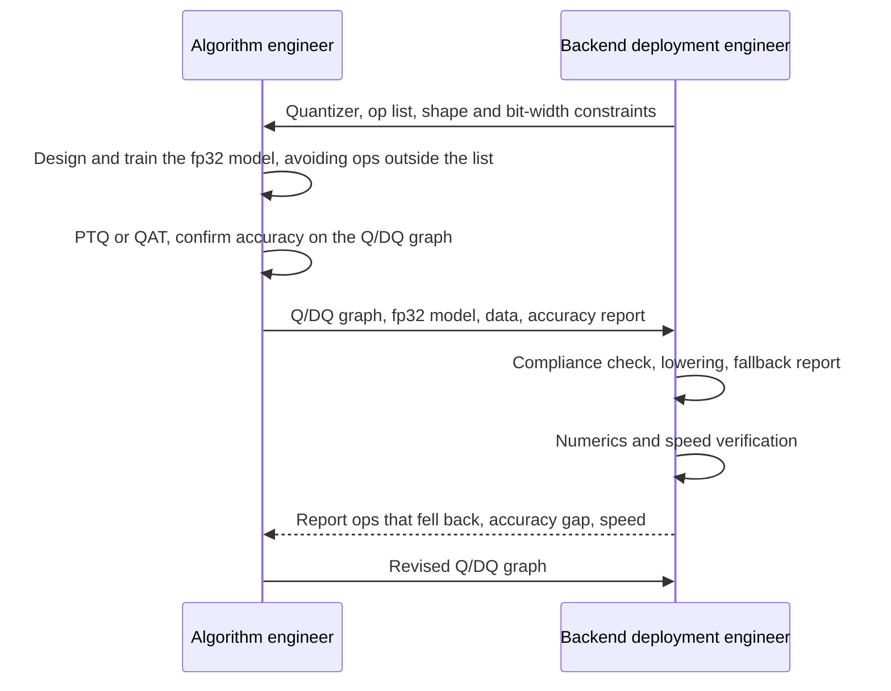

# End-to-End PT2E: Quantization, Backend Deployment, and Who Does What on Edge Devices

> ### 🌐 **English** ｜ [繁體中文](README.zh-TW.md)

[](https://bobondemon.github.io/pt2e_quantize_and_deploy/en/)
[](https://colab.research.google.com/github/bobondemon/pt2e_quantize_and_deploy/blob/main/en/m01_hello_pt2e/00_overview.ipynb)
[](LICENSE)

A few words before we start

> These days it feels like teaching material is mostly read by AI, and AI probably already knows all of this\
> If AI helps with quantization and deployment, do humans — the bottleneck — still need to understand it? I don't know, but right now I want to write down what I've learned from experience\
> Anyway, this course is written for humans, assuming anyone still wants to understand ...

A hands-on course on quantizing models to int8 with PyTorch 2 Export (PT2E) and handing them to backends such as ExecuTorch + XNNPACK and ONNX Runtime.

The course targets edge devices with limited compute and power (for example always-on sensing and voice wake-up): small models, a fully integer graph (mostly int8), fixed shapes, and a limited set of ops supported by the backend.
Weight-only int4 and KV-cache quantization, as commonly used for LLMs, are out of scope.

**📖 Read it on the website: <https://bobondemon.github.io/pt2e_quantize_and_deploy/en/>** (中文版：<https://bobondemon.github.io/pt2e_quantize_and_deploy/>)

This repo holds the source of the course. The website lays the chapters' notebooks, figures, and tables out as a book, with a sidebar table of contents and search — easier to read than opening files one by one on GitHub.

## Who is this for
If you need to train, quantize, and deploy models on the edge, or you want to know how the two roles — the *model algorithm engineer* and the *backend deployment engineer* — divide their work, this course is written for you (a human).
> [TODO]: consider writing a role guide for AI agents

- Algorithm engineers who have trained models in PyTorch and want to quantize them to int8 and deploy them on a CPU or accelerator.
- People who have read `torch.ao.quantization`-era articles and want to know how PT2E is used today: the API moved to torchao in torch 2.14, so the import paths in older articles mostly no longer work.
- Backend engineers responsible for model deployment who need to write or read a Quantizer.

No quantization background is needed; you should know how to write and train an `nn.Module`. Every step of PT2E edits a `torch.fx` graph;
if you are not familiar with fx, first read [PyTorch FX Graph / Node basics](https://bobondemon.github.io/2025/07/29/%E7%AD%86%E8%A8%98-PyTorch-FX-%E7%9A%84-Graph-Node-%E4%B8%80%E4%BA%9B%E5%9F%BA%E7%A4%8E%E6%A6%82%E5%BF%B5/) (blog post, in Chinese); M00 also walks through it with small examples.

## Two parts, two roles

The course is split into two parts at the **Q/DQ graph** produced by `convert_pt2e`, and in practice each part is usually owned by one role:

| | Part 1 (M01–M06) | Part 2 (M07–M10) |
|---|---|---|
| What happens | fp32 model → PTQ / QAT → Q/DQ graph | Q/DQ graph → the backend's int8 kernels → device |
| Role | Algorithm engineer: modeling, training, quantization | Backend deployment engineer: picks the platform, provides the Quantizer, lowering and verification |

The two roles do not work separately: the Quantizer is designed around the backend's own kernels, so you pick the backend first and then quantize. The order of collaboration:



The last two steps usually go back and forth several times. For what gets handed over and which segment to check first when accuracy drops, see the [website home page](https://bobondemon.github.io/pt2e_quantize_and_deploy/en/).

## How to read it and how to run it

- **Read**: on the [website](https://bobondemon.github.io/pt2e_quantize_and_deploy/en/), in the order of the sidebar. Each chapter starts with an overview (`00_overview.ipynb`) stating the questions it answers and its core concepts; the notebooks after it verify them hands-on one by one.
  All notebook outputs have already been run, so you can see the results without executing anything.
- **Run it yourself**: click the **Open in Colab** button at the top of each notebook and run it cell by cell in Colab, changing parameters and rerunning.
  The first code cell downloads the course code and installs pinned package versions (it takes a few minutes the first time); after that, run the cells in order.
  The models are all tiny and the data is generated by code, so everything runs on CPU alone — no dataset download.
- **Run on your own machine**: set up the environment with [uv](https://docs.astral.sh/uv/); the commands are in the `README.md` of each chapter folder.

The outputs stored in the notebooks come from macOS arm64, Python 3.12, torch 2.14.0, torchao 0.18.0, executorch 1.5.0, onnxruntime 1.30.0.
Notebooks whose numerics or speed depend on the platform print the execution environment first, then explain according to the measured results.

## Repository layout

```text
.
├── index.qmd                  Chinese site home page: storyline, learning path, the two roles
├── part1_overview.qmd         Part 1 overview (M01–M06)
├── part2_overview.qmd         Part 2 overview (M07–M10)
├── m00_export_basics/ … m10_custom_backend/
│   ├── 00_overview.ipynb      Overview of each chapter (Chinese)
│   ├── 01_….ipynb …           Notebooks to read in order (Chinese)
│   ├── README.md              Chapter index and how to run (English)
│   └── README.zh-TW.md        Same, in Chinese
├── en/                        English edition of the site: index.qmd, the overviews, and the m00–m10 notebooks
├── common/                    Small utilities shared by the notebooks (plotting, tiny models, synthetic data, a single entry point for the PT2E API)
├── _quarto.yml                Site config (Chinese); en/_quarto.yml is the English one
└── .github/workflows/publish.yml   Builds both sites and publishes them to GitHub Pages on push to main
```

The Chinese notebooks live in the chapter folders (`m*/`) and the English ones in `en/m*/`; the two stay in sync chapter by chapter.

## Environment and commands (for people who want to modify the course)

The environment is managed with [uv](https://docs.astral.sh/uv/) (Python 3.12, venv in `.venv/`); always use `uv run`, no need to activate.
graphviz subgraphs need the system `dot` executable. From the project root:

```bash
brew install graphviz                          # Ubuntu: sudo apt install graphviz
uv sync --group executorch --group site        # executorch is only used by M08; site is the pip build of quarto
uv run python check_env.py                     # versions, where the PT2E API lives, and one end-to-end quantization run
uv run --group site quarto preview             # preview the Chinese site in the browser
uv run --group site quarto preview en          # preview the English site
uv run --group site quarto render              # build the Chinese site into _site/
uv run --group site quarto render en           # build the English site into en/_site/ (CI moves it to _site/en/)
```

Notebooks are not executed during the site build; the outputs stored in the files are used. So after changing a notebook, rerun it before building the site.
To rerun one notebook (`--inplace` writes the new outputs back to the file):

```bash
uv run jupyter nbconvert --to notebook --execute --inplace \
  --ClearMetadataPreprocessor.enabled=True m10_custom_backend/01_vpu_quantizer.ipynb
```

### Writing notebooks

`.ipynb` is the only source file. A more convenient way to edit is [jupytext](https://jupytext.readthedocs.io/)'s percent format
(`# %%` is a code cell, `# %% [markdown]` is prose): edit in a scratch folder outside the repo, then convert back to a notebook:

```bash
# notebook → percent .py (outside the repo)
uv run jupytext --to py:percent --output /tmp/draft.py m01_hello_pt2e/01_minimal_ptq.ipynb

# percent .py → notebook, then run it once more to write the outputs in
uv run jupytext --to ipynb --output m01_hello_pt2e/01_minimal_ptq.ipynb \
  --update-metadata '{"kernelspec":{"name":"python3","display_name":"Python 3","language":"python"},"jupytext":null}' \
  /tmp/draft.py
```

Don't leave a `.py` with the same name as a notebook in the repo: when a folder has a same-named `.py`, Quarto skips that `.ipynb`.

### The shared TinyConvNet weights

Training is not bit-reproducible across platforms (or even thread counts), but the numbers in the notebooks depend on the exact weights.
So `common/tiny_net.pt` holds the weights of the trained `TinyConvNet` (epochs=20, seed=0; trained on macOS arm64), and `trained_tiny_net()` loads it instead of retraining.
Every platform therefore quantizes the same model. To regenerate it (this changes the numbers in many notebooks, so rerun them afterwards):

```bash
uv run python tools/make_tiny_net_weights.py          # trains from scratch and writes common/tiny_net.pt
uv run python tools/make_tiny_net_weights.py --check  # loads the file and prints check numbers
```

QAT training in M06 still starts from these weights but is not bit-reproducible, so those numbers can differ slightly between platforms.

### Verification

There is no separate test suite. The `assert`s inside the notebooks check every claim in the course, so verification means rerunning all the notebooks
(about 10 minutes in total on a macOS arm64 CPU):

```bash
uv run python check_env.py
uv run jupyter nbconvert --to notebook --execute --inplace --ClearMetadataPreprocessor.enabled=True m*/*.ipynb
```

Then confirm there is no error or stderr in the outputs (torch's `W…` warnings show up in stderr); the command below should print nothing:

```bash
uv run python -c "import json,glob; [print(p) for p in glob.glob('m*/*.ipynb') if any(o['output_type']=='error' or o.get('name')=='stderr' for c in json.load(open(p))['cells'] for o in c.get('outputs',[]))]"
```

Type checking uses pyright and must give 0 errors. First convert the notebooks to `.py` with the jupytext command above into a folder outside the repo, then check;
the M10 notebooks `import vpu_quantizer`, so when checking, add `m10_custom_backend/` to `extraPaths` with a `pyrightconfig.json`.

```bash
uvx pyright --pythonpath .venv/bin/python common/ <folder holding the converted .py files>
```
